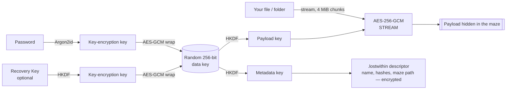

<div align="center">


# LOST WITHIN

**Secure File Maze**

*Enter. Disappear. Find your way back.*

Encrypt any file or folder, bury it deep inside a randomly generated maze of folders,<br>
and bring it back with a password — even if it's 70 GB.


-41CD52?logo=qt&logoColor=white)


</div>

---

## Why Lost Within?

Most encryption tools hand you back one obvious file sitting next to the original. Lost Within makes
the encrypted data **disappear into a labyrinth**: dozens to thousands of randomly named folders, dead
ends and decoy files, with the real payload somewhere deep inside. A small `.lostwithin` descriptor
plus your password is the only way back.

Under the theatre is serious, boring, well-reviewed cryptography: **AES-256-GCM** authenticated
encryption, **Argon2id** password hashing, and **SHA-256** integrity checks — all from established
libraries, with no home-made crypto.

> [!IMPORTANT]
> **The maze hides — encryption protects.** The maze keeps the name and location out of casual sight,
> but anyone with disk access can find the payload. Your data is safe because it is encrypted with a
> key derived from your password, not because it is hard to find. See **Limitations** below.

## ✨ Features

| | |
|---|---|
| 🔐 **Authenticated encryption** | AES-256-GCM in 4 MiB chunks (STREAM construction). Detects wrong passwords, tampering, corruption, reordering and truncation. |
| 🧠 **Argon2id key derivation** | Memory-hard password hashing (RFC 9106 parameters by default, stronger presets available). |
| 🌀 **Configurable maze** | Choose depth, folder-name length, branching factor, decoy passages and decoy files — validated live against Windows path limits. |
| 🐘 **Huge files, tiny memory** | Fully streaming. Tested with a 6 GB file at ~90 MB peak RAM; 70 GB+ works the same way. |
| 📁 **Files *and* folders** | Folders are packed on the fly and restored with their full structure. |
| 🗝️ **Optional Recovery Key** | A second, independent way to unlock (`LW1-XXXX-…`) with a typo-catching checksum. |
| 🕵️ **Private by design** | The original filename, size, hash and path through the maze are encrypted inside the descriptor. Payload and decoys are indistinguishable random bytes. |
| ✅ **Verified restore** | SHA-256 checked before the file appears under its real name. Path traversal blocked. Nothing overwritten without asking. |
| 🧯 **Crash-safe** | Cancel or errors roll back everything. A journal cleans up after crashes or power loss. |
| 🖱️ **Drag & drop** | Drop a file/folder to bury it, drop a `.lostwithin` to recover it. |
| 📊 **Live progress** | Bytes, percentage, speed, ETA, current stage — and a lantern travelling through the maze. |
| 🧪 **Test mode** | One click runs the whole bury → maze → recover workflow (plus attack simulations) on throwaway files. |
| ⌨️ **CLI included** | `bury`, `recover`, `inspect`, `--self-test` for scripting and servers. |

## 📸 Screenshots

<table>
<tr>
<td width="50%"><br><sub><b>Bury File</b> — source, maze location, descriptor and passphrase with strength meter</sub></td>
<td width="50%"><br><sub><b>Maze Configuration</b> — live validation and preview of the labyrinth</sub></td>
</tr>
<tr>
<td><br><sub><b>Encryption Progress</b> — speed, ETA and stage tracking</sub></td>
<td><br><sub><b>Recovery</b> — descriptor details, automatic maze detection, unlock</sub></td>
</tr>
<tr>
<td colspan="2" align="center"><br><sub><b>You found your way back.</b> — SHA-256 verified</sub></td>
</tr>
</table>

## 🚀 Quick start

### Option A — Windows executable

Download `LostWithin.exe` from the [Releases](../../releases) page and run it. No installation needed.

> Windows SmartScreen may warn about an unsigned app: click **More info → Run anyway**.

### Option B — Run from source

Requires **Python 3.12+** ([python.org](https://www.python.org/downloads/), tick *Add python.exe to PATH*).

```bat
git clone https://github.com/<your-username>/lost-within.git
cd lost-within
py -3.12 -m venv .venv
.venv\Scripts\activate
pip install -r requirements.txt
python main.py
```

<details>
<summary>macOS / Linux</summary>

```bash
git clone https://github.com/<your-username>/lost-within.git
cd lost-within
python3 -m venv .venv && source .venv/bin/activate
pip install -r requirements.txt
python main.py
```

The app is designed for Windows (path limits, Explorer integration) but runs cross-platform.
</details>

### Check everything works

```bat
python main.py --self-test
```

```text
Lost Within self-test
  ✓ Small file round trip
  ✓ Multi-chunk file (5.2 chunks)
  ✓ Folder round trip
  ✓ Wrong password is rejected
  ✓ Modified ciphertext is detected
  ✓ Truncated (incomplete) payload is detected
  ✓ Cancelled bury cleans up
  …
15/15 checks passed. Temporary files removed.
```

## 🧭 How to use

### Bury a file

1. **Drop** a file or folder onto the window (or *Browse Files*), then press **BURY FILE**.
2. Choose where the maze goes, name the descriptor, and set a **strong passphrase**.
   Optionally tick **Recovery Key**.
3. **Shape the maze** — depth, name length, branching, decoys. Invalid settings are caught before
   anything is written.
4. Press **ENTER THE MAZE** and watch it disappear.

```text
E:\Vault\
├── example.zip.lostwithin          ← recovery descriptor — keep it safe, back it up
└── LostWithin_q8Kp91aZ\
    ├── aZ72Lm9Q\ …                 ← dead ends, decoy passages, decoy files
    └── P91xQa3k\
        └── mK72Lp0w\
            └── …\
                └── X3fq81Lw.dat    ← the encrypted payload (random name)
```

### Find your way back

1. Press **RECOVER** or drop the `.lostwithin` file onto the window.
2. The maze is found automatically (or select it if you moved it).
3. Enter your password or Recovery Key, choose a destination, press **FIND YOUR WAY BACK**.

```text
✓ You found your way back.

File recovered successfully.

Original file:
example.zip

Integrity:
SHA-256 verified
```

### Command line

```bat
python main.py bury "D:\Projects\thesis.zip" "E:\Vault" --depth 10 --recovery-key
python main.py inspect "E:\Vault\thesis.zip.lostwithin"
python main.py recover "E:\Vault\thesis.zip.lostwithin" "D:\Restored"
python main.py recover "E:\Vault\thesis.zip.lostwithin" --verify-only
```

Passwords are always prompted (hidden) — never passed as arguments. For automation use
`--password-env VARNAME`.

## 🔬 How it works



- A **random data key** encrypts each burial; your password (and optional Recovery Key) only *wraps* it.
- Data is streamed in **authenticated chunks**: each chunk's nonce includes a counter and a
  "last chunk" flag, so modified, reordered, missing or truncated data is always detected.
- The **descriptor's** public fields are bound to its encrypted section, so any edit to it is detected.
- On recovery, data is decrypted to a hidden temporary file, both SHA-256 digests are verified,
  and only then is it moved into place under its (sanitised) original name.

| Failure | Detected by |
|---|---|
| Wrong password | Key unwrap fails — before any file is read |
| Modified / corrupted payload | Per-chunk GCM tag + SHA-256 |
| Truncated / incomplete payload | Final-chunk flag + size check |
| Reordered or appended data | Chunk counter in nonce |
| Edited descriptor | Authenticated associated data |
| Malicious filename (`..\..\evil.exe`) | Filename sanitisation + path-traversal guard |

Full details: **[docs/TECHNICAL.md](docs/TECHNICAL.md)** — architecture, file formats, security model.

## ⚠️ Limitations

Please read these. Honest limits are part of the security model.

- **The maze is obfuscation, not security.** The payload is usually the largest file in the maze.
- **Your password is the real protection.** Anyone holding the descriptor can guess offline; Argon2id
  slows them down but cannot save a weak password. Use 4+ random words.
- **Lose the descriptor and recovery may be impossible.** Back it up, ideally away from the maze.
  It does not contain your password.
- **No protection on a compromised computer** (malware, keyloggers, someone at your unlocked PC).
- **Memory wiping is best-effort.** Python cannot reliably erase secrets from RAM or the page file.
- **Your original is not deleted**, and deletion is not reliable on SSDs or cloud-synced folders.
- **The default descriptor name reveals the original filename** — use *Randomize* to hide it.
- **Not independently audited.** It uses the widely reviewed `cryptography` library and standard
  constructions, but this application has not had a professional security audit.

## 🛠️ Build the .exe

```bat
build.bat
```

Runs the tests, then builds `dist\LostWithin.exe` with PyInstaller:

```bat
pyinstaller --noconfirm --clean --windowed --onefile --name LostWithin ^
  --icon assets\icons\lost_within.ico --add-data "assets;assets" ^
  --collect-submodules argon2 --exclude-module pytest --exclude-module PIL --exclude-module tkinter ^
  main.py
```

## 🧪 Tests

```bat
python -m pytest
```

75 tests covering streaming encryption at every chunk boundary, tampering and truncation, Argon2id
correctness, maze generation and validation, path traversal, full bury → recover workflows for files
and folders, conflict handling, cancellation and crash clean-up.

## 📂 Project structure

```text
lost-within/
├── main.py              entry point (GUI, or CLI with arguments)
├── cli.py               command-line interface
├── core/                engine — crypto, maze, bury, recover (no GUI code)
├── models/              descriptor format, settings
├── utils/               random names, validation, filesystem helpers
├── ui/                  PySide6 interface (8 pages)
├── tests/               pytest suites
├── assets/icons/        app icon
└── docs/                technical docs and screenshots
```

## 🤝 Contributing

Issues and pull requests are welcome. Please run `python -m pytest` and `python main.py --self-test`
before submitting. If you find a security problem, please open a private security advisory on GitHub
rather than a public issue.

## 📜 License

[MIT](LICENSE)

<div align="center">
<br>
<sub><b>LOST WITHIN</b> — Enter. Disappear. Find your way back.</sub>
</div>
